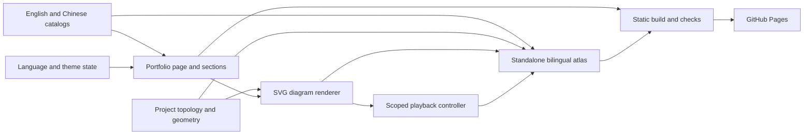

# Portfolio architecture blueprint

Reviewed 2026-11-07. Scope: the portfolio application and the engineering meaning
of its six featured diagrams. The site describes project capabilities; it does
not execute those projects or establish their deployment status.

## Application structure

The portfolio is a React application built with vinext/Vite and exported as a
static site to GitHub Pages. Its architecture separates content, presentation,
and browser state. Python services shown in the project diagrams belong to
other repositories, not to the portfolio's runtime.

| Component | Responsibility | Owning source |
| --- | --- | --- |
| Page composition | Metadata, provider, and ordered sections | `app/page.tsx` |
| Content catalogs | Identity, project copy, professional facts, translations | `app/content/` |
| Preferences | Language/theme state, browser history, persistence | `app/components/portfolio/preferences.tsx` |
| Casebook | Project selection, keyboard navigation, narrative and diagram | `app/components/portfolio/hero-section.tsx` |
| Diagram specification | Nodes, directed relationships, routes, example path | `app/content/project-diagrams.ts` |
| Diagram renderer | SVG primitives, labels, accessible names, reading controls | `app/components/portfolio/architecture-view.tsx` |
| Playback | Play, pause, resume, replay, reduced motion, cleanup | `app/lib/diagram-playback.mjs` |
| Atlas generation | Reuse the same renderer, translations, styles, and controller | `scripts/build-project-diagrams.mjs` |

The provider supplies data to sections; presentation does not maintain a second
project catalog. The topology file imports only a case-study type from the copy
catalog, so that relationship does not introduce a runtime import cycle.

## Content and state

`casebook.config.ts` owns both languages for the case studies and diagram labels.
The remaining Chinese catalog is in `zh-CN.config.ts`. Project IDs, destinations,
product names, technologies, and professional facts keep their existing identity.
Content and translation checks run before publication.

The browser owns temporary selection and playback state. There is no portfolio
application database or authenticated project backend. The résumé registration
form submits a plain GET request to the external Resume Tailor application;
that application owns sign-up and passwords. Private projects remain unlinked.

Language/theme preferences are distinct from generated content. A language change
updates the catalog and browser history without fetching another rendered page.
Project changes reset diagram playback rather than starting an animation.

## Diagram semantics and source review

The six views answer different questions. They should not be normalized into a
single input–processor–review template.

| Project | View | Engineering distinction |
| --- | --- | --- |
| VSDA Deep Agent | Specialist-routing architecture | A supervisor selects retrieval, isolated analysis, or enterprise service agents under shared execution controls. |
| Release-Email Intelligence Pipeline | Processing and failure-recovery flow | Saved release records precede acknowledgment and eligible job submission; failures remain retryable. The reviewer reads records independently. |
| Resume Tailor Harness | Evidence-checking flow | Draft claims and source facts converge at checks; flagged text has a revision path, and PDF layout has a separate review. |
| Requirement Buddy | Ownership swimlanes | Research, authorship, independent review, and application-owned publication checks are different responsibilities. |
| Enterprise Automation Workflow | Integration/execution layers | Typed service clients and bounded retrieval support agent workflows and conventional reports or exports. |
| Pantry Manager | Two-part interaction sequence | Receipt import saves eligible items and offers undo. A later batch status update asks for confirmation before applying changes. |

The Pantry review corrected the earlier implication that every receipt waits for
batch confirmation. At `c78ace03f3491a0f91f249b60a621ca34b65a26a`,
`app/handlers/meta.py:704–785` calls receipt ingestion and renders an undo action;
`app/ingest_service.py:94–148,201–242` parses, filters, and saves items;
`app/batch_service.py:145–192` handles the separate confirmation/apply transition.

Other reviewed revisions and source paths are recorded in
`app/content/github-evidence.md`. The source-backed Archify review produced
specialist-routing, release-persistence, and Pantry sequence artifacts, with
validation, provenance, real-browser checks, and captured light/dark views.
Those local candidates and receipts live under `.archify/` and are excluded from
the published site. Their source links include private repository identities.
The public atlas uses the portfolio's own renderer and contains no private
repository links.

## Rendering and interaction

Each connector has semantic `from` and `to` IDs in addition to its authored
orthogonal coordinates. `playback` identifies an example path. The atlas build
rejects unknown endpoints, duplicate node IDs, missing translated labels,
non-orthogonal segments, and disconnected examples. Sequence playback follows
message order rather than pretending every message is a graph traversal.

SVG titles and descriptions name the complete view. A labeled, focusable scroll
region keeps the font-relative reading canvas (595px at default settings) at readable size on phones. Keyboard users
can pan with arrow keys; the document itself does not overflow sideways. A full
atlas link offers a wider reading surface and a direct anchor for the project
and language. Printing fits the complete diagram to the page.

Body text is 17px across screen sizes, with 1.75 line spacing; Chinese
uses 1.85. Rendered diagram titles match body text at 17px; details are approximately 16px, and relationship labels and legends 15px. The complete canvas scales with browser font preferences, preserving wrapping and geometry. Long project titles put their subtitles on
the next line. The palette and font families remain the approved casebook system.

## Motion lifecycle

Motion explains an example; it does not reveal missing diagram content. Every
node, relationship, label, and outcome is visible before JavaScript runs.

1. The renderer emits the complete SVG and initially disabled playback controls.
2. The shared controller binds only to that figure and enables playback when
   reduced motion is off.
3. Play samples the authored route and animates one decorative token using
   transform and opacity. It runs once for 760ms per relationship.
4. Pause preserves the current position; resume continues; replay starts again.
5. Completion hides the token. Page hiding pauses it. A reduced-motion change
   cancels playback, and component cleanup cancels the animation and listeners.

The standalone HTML embeds that same controller rather than duplicating its
implementation. It performs no network requests or storage writes. Diagram
playback does not change project data or claim to be a live backend execution.

## Validation and errors

The build fails on invalid diagram contracts rather than publishing an incomplete
atlas. React and the standalone page share copy, geometry, styles, and motion
logic, which reduces drift between the two outputs.

`npm run check:content` checks the catalogs and translations; `typecheck` and
`lint` cover source; `npm test` builds the actual static artifact and checks its
rendered HTML. Browser tests exercise both languages/themes, project selection,
language history, search, local panning, and playback lifecycle. Visual review
also measures text bounds and label/connector clearance in the rendered SVGs.
These tests establish portfolio behavior, not live-provider acceptance for the
projects it describes.

## Build and deployment

`npm run build` first regenerates `public/project-architectures.html`, then builds
and prerenders the site. `scripts/build.mjs` preserves the local-history
initializer's ordering and handles the documented Windows/Node build-exit case.
`scripts/export-github-pages.mjs` prepares the static publication directory.

`.github/workflows/deploy-pages.yml` runs content, type, lint, build, rendered HTML,
and browser checks on pushes to `main`, then uploads and deploys the Pages artifact.
The workflow owns deployment; there is no long-running portfolio application
server in production. Font files are local on the portfolio. The standalone
atlas uses Google Fonts as its only external asset dependency.

## Extending the casebook

Add a project to the catalog, give it a stable featured ID, and write both language
versions of its case. Choose the diagram type from the actual behavior. Add
nodes and directed edges with source-backed responsibilities, then author their
geometry and a representative example route. Preserve failure branches,
ownership, review conditions, and the distinction between request and result.

Run the existing checks and inspect the real labels in both languages at desktop
and phone widths. Adding a diagram does not require another renderer or playback
engine. If it needs a new primitive, extend the shared renderer and keep its
accessible/static/print behavior intact.

Revisit this blueprint when the content model, state ownership, renderer,
playback, or deployment changes. Record architectural reasoning from observed
code or explicit decisions; do not infer why a dependency was originally chosen.
